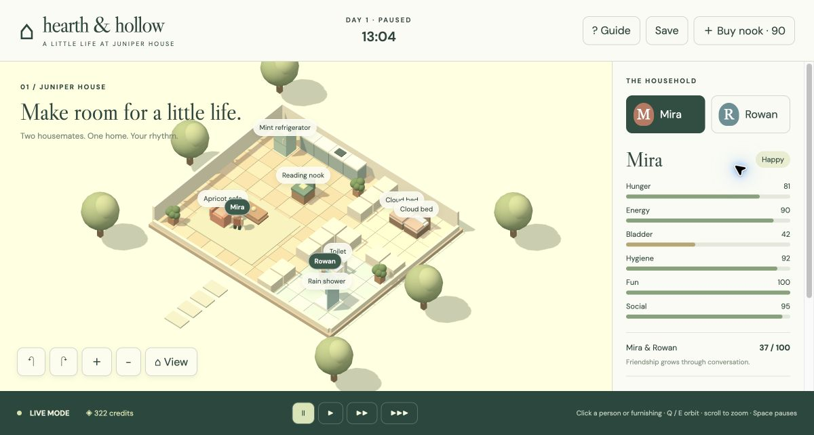

# Acceptance evidence — October 16, 2026

## Automated

39 Node behavioral tests pass. JavaScript syntax checks and the Vite production build pass. Dependency audit reports zero vulnerabilities. Independent spec and standards reviews identified decorative collision and duplicate reciprocal-chat completion defects; both were repaired and regression tested before publication.

## User's local Chrome, ordinary input

No simulation state was injected through developer hooks. Interactions used native/accessibility clicks, keyboard input and visible controls. Browser control intermittently lost its connection; reconnecting the same tab and using Chrome's native accessibility surface allowed acceptance to continue. No Mac lock/security settings changed.

| Check | Observed result |
|---|---|
| Household selection | Rowan panel showed distinct needs (64/50/45/70/55/35); switching back restored Mira's panel |
| Contextual furniture interaction | Refrigerator opened Make a meal; shower, bed, sofa and purchased nook showed their own activities |
| Queue order and pending cancel | Paused meal → shower → sleep; removed shower, retained meal → sleep |
| Physical movement and restoration | Meal first showed walking with hunger 42; later meal and sleep completed, hunger 97 and energy 100. The resident crossed room doorway gaps for bedroom/bathroom activities; shower later restored hygiene from 55 to 99 |
| Active cancellation | Cancelled current walking meal route; queue became empty. Started nearby Read a novel, observed using with progress 1.8176, paused and cancelled; queue became empty |
| Time | Pause retained clock/positions/need values between observations; normal/double/triple controls visibly advanced time and displayed their selected state |
| Social | Friendly conversation queued with the other resident; both met; completion log appeared and friendship rose from 28 to 37 |
| Autonomy | Idle residents automatically started social/toilet care; Mira's low fun led to Read a novel marked using · autonomous, later fun 99 and Happy mood |
| Build/buy | Free floor placement created a Reading nook and funds changed 412 → 322; repeat placement on the occupied footprint rejected and funds remained 322 |
| Camera | Orbit, zoom and keyboard pan visibly changed the home view; Reading nook in transformed view still opened Daydream |
| Save/reload | Manual save followed by browser reload retained paused 13:04 clock, needs 81/90/42/92/100/95, friendship 37, funds 322, purchased nook and queued Daydream. Camera reset as documented |
| Finish | Cancelled test queue, saved, returned sidebar to top and left preview available, paused |

The final screenshot below contains only game content, without personal browser chrome. It was visually inspected before staging.

## Scope of evidence

Tests validate routing against simulated walls, furniture and fixed decorative footprints, object exclusivity, queue effects, precise speed ratios, mood effects and malformed saves. The browser checks validate the actual visible loop and normal inputs. They do not establish exact fidelity to all Sims 4 rules, full animation, browser/mobile coverage, or an entire multi-day economy. Source-based limits are in README.md.
